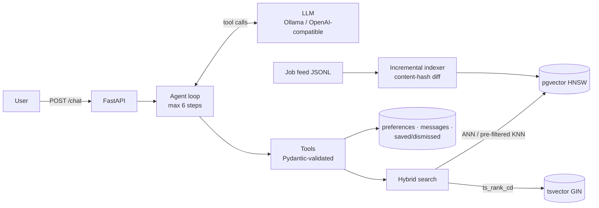

# AeroMatch

**A conversational job-matching agent.** You tell it what you're looking for in plain language
("I'm a fresher in Pune who knows Kotlin"). It remembers what you said, searches a live job index
with hybrid semantic + keyword retrieval, and replies with structured recommendations grounded in
real postings.

[](https://github.com/jaimeet14/aeromatch/actions/workflows/ci.yml)
 

## What it does

- **Tool-using LLM agent.** A bounded tool-use loop over any OpenAI-compatible model (Ollama, OpenAI,
  Groq) with six tools: `search_jobs`, `get_job_details`, `update_preferences`, `save_job`,
  `dismiss_job`, `final_answer`. Tool JSON schemas are generated from Pydantic models, so the
  schema the LLM sees and the validation of what it sends back come from one source.
- **Structured, grounded output.** Every turn ends in a `final_answer` that has to validate against
  a schema (`message`, `job_ids`, `follow_up_question`). Any `job_id` not returned by a tool in the
  conversation is rejected and sent back to the model to fix, so it can't recommend invented jobs.
  Invalid tool arguments go back the same way for the model to self-correct.
- **Memory.** Short-term: the full transcript, including tool calls, is stored in Postgres and
  replayed each turn. Long-term: preferences the user states (skills, experience, cities, work mode,
  minimum salary) are saved through `update_preferences`. They go into the system prompt and act as
  default search filters.
- **Hybrid semantic search.** pgvector HNSW for vector search plus Postgres full-text search with
  weighted fields, fused with weighted Reciprocal Rank Fusion. Results are then personalised: jobs
  the user dismissed are excluded, and jobs matching the user's skills are boosted.
- **Constantly changing index.** The indexer takes full feed snapshots, upserts by `external_id`,
  re-embeds only rows whose content hash changed, deactivates postings that left the feed, and
  re-activates ones that come back.

## Architecture



**Schema** (`aeromatch/schema.sql`): `companies`, `jobs` (vector + generated `tsvector`, HNSW, GIN
and partial filter indexes), `users`, `user_preferences`, `conversations`, `messages` (JSONB
tool calls), and `user_job_actions`.

## Results

### Retrieval: 144 labelled queries, 3,000 postings, 24 role families

The weights were tuned on the dev half (even query IDs) and every number below is on the held-out
test half (72 queries per setting). Queries come in three styles: a job title, a list of skills,
or a plain-language **paraphrase** that avoids the job title.

| Setting | System | nDCG@10 | Recall@10 | MRR | Paraphrase nDCG@10 |
|---|---|---|---|---|---|
| No filters | Keyword (Postgres FTS) | 0.759 | 0.757 | 0.778 | 0.277 |
| | Vector (pgvector) | 0.866 | 0.869 | 0.868 | 0.677 |
| | Hybrid, equal-weight RRF | 0.859 | 0.854 | 0.896 | 0.598 |
| | **Hybrid, tuned RRF** | **0.895** | **0.892** | **0.903** | **0.726** |
| With filters | Keyword | 0.727 | 0.718 | 0.787 | 0.319 |
| | Vector | 0.894 | 0.893 | 0.931 | 0.809 |
| | Hybrid, equal-weight RRF | 0.834 | 0.840 | 0.910 | 0.624 |
| | **Hybrid, tuned RRF** | **0.902** | **0.903** | **0.951** | **0.823** |

Hybrid retrieval latency: p50 15 ms / p95 50 ms without filters, p50 6 ms / p95 29 ms with filters
(CPU, 2 cores). Reproduce with `python -m scripts.eval_retrieval`.

**Incremental indexing:** with 5% of postings edited, 2% removed and 3% added, re-indexing
re-embeds only the changed rows (149 of 3,030), and the whole run takes 0.4 s.
Reproduce with `python -m scripts.feed_churn`.

### Agent: 16 multi-turn scenarios, 22 turns

`python -m scripts.eval_agent` checks for each turn: the expected tools were called, the filters
that reached search (including ones recalled from memory) are right, the output was valid on the
first try, and the precision of recommended jobs by role family.

| System | Tool selection | Filter accuracy | Valid on first try | Recommendation precision |
|---|---|---|---|---|
| No-LLM baseline (raw message → search → top 3) | 0.682 | 0.000 | 1.000 | 0.733 |
| `qwen2.5:7b-instruct` via Ollama | _run locally_ | | | |

## Lessons from the evals

1. **HNSW silently drops filtered results.** After an `ANALYZE`, Postgres started using the HNSW
   index for broad filters such as "city = Bengaluru". HNSW filters *after* the approximate-nearest-
   neighbour walk, so most relevant postings never entered the candidate window, and filtered vector
   nDCG fell from 0.894 to 0.839 between two identical runs. Fix: when filters are present,
   pre-filter in a materialised CTE and run exact KNN on that subset (`search.vector_ids`). On
   pgvector ≥ 0.8, `hnsw.iterative_scan` is an alternative.
2. **Equal-weight RRF made results worse than vector search alone.** Generic words in paraphrased
   queries ("build", "work") matched keywords across every role family. Down-weighting the keyword
   ranking (0.75 unfiltered, 0.25 filtered, both tuned on dev only) turned hybrid into the best
   system in both settings.
3. **Re-listed postings stayed hidden.** A posting removed and later re-added with identical content
   had a matching hash, so the indexer skipped it and left it inactive. Now covered by
   `test_missing_jobs_deactivated_then_revived`.

## Quickstart

```bash
docker compose up --build -d                  # Postgres 16 + pgvector, API on :8000
make seed                                     # index data/jobs.jsonl
ollama pull qwen2.5:7b-instruct               # any tool-calling model works

curl -X POST localhost:8000/users -H 'content-type: application/json' -d '{"name":"Asha"}'
curl -X POST localhost:8000/chat -H 'content-type: application/json' \
  -d '{"user_id":1,"message":"I am a fresher in Pune and know Kotlin. Any jobs?"}'
```

Also available: `GET /search?q=...&city=...&work_mode=...&years_experience=...&min_salary_lpa=...&mode=hybrid|vector|lexical`,
`GET /users/{id}/preferences`, `GET /users/{id}/saved`, and interactive docs at `/docs`.

To use a hosted model instead, set `LLM_BASE_URL`, `LLM_API_KEY` and `LLM_MODEL` (see `.env.example`).

## Tests and CI

`pytest -q` runs 29 tests against a real Postgres + pgvector database. They cover filters as hard
constraints, pre-filtered KNN completeness, RRF, personalisation, incremental indexing, tool
validation, and the agent loop (grounding rejection, argument repair, nudge-to-structured, step
budget, memory across turns, per-user conversation scoping), plus the HTTP API. The agent tests use
a scripted LLM, so they're deterministic. GitHub Actions runs the tests and then a **retrieval
quality gate** that fails the build if hybrid nDCG@10 drops below 0.85.

## Data

`data/jobs.jsonl` is a **synthetic** India job feed (`scripts/generate_data.py`). Every posting has
a known role family, which is what makes graded relevance labels possible without hand-labelling.
Real feeds plug in through the same `JobIn` schema. Embeddings default to
[WordLlama](https://github.com/dleemiller/WordLlama) (256-d static embeddings, CPU-only, no
service to run). Set `EMBEDDER=ollama:nomic-embed-text` and `EMBED_DIM=768` to switch models.

## Project structure

```
aeromatch/
  agent.py        tool-use loop, grounding check, structured final answer
  tools.py        Pydantic tool definitions -> JSON schemas + validated dispatch
  search.py       lexical, vector (ANN / pre-filtered KNN), weighted RRF, personalisation
  memory.py       transcript + preferences + saved/dismissed
  ingest.py       content-hash incremental indexer
  embeddings.py   WordLlama / Ollama / hashing (tests) embedders
  llm.py          OpenAI-compatible client + scripted LLM for tests
  main.py         FastAPI app
  schema.sql
scripts/          generate_data, ingest, eval_retrieval, eval_agent, feed_churn
tests/            29 pytest tests
```
